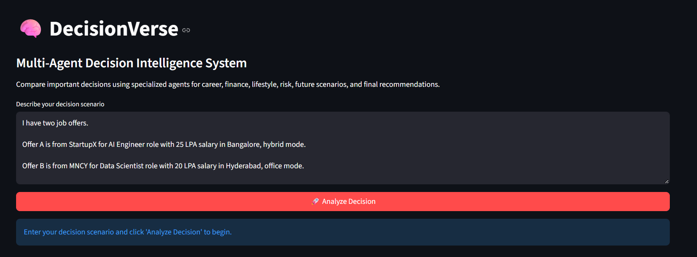
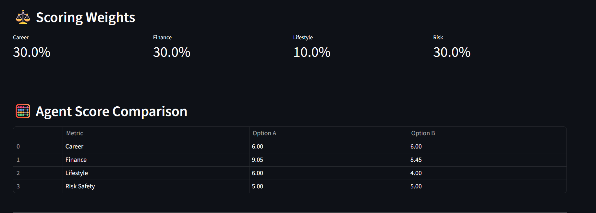
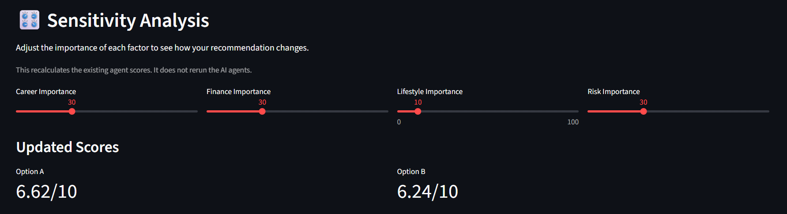
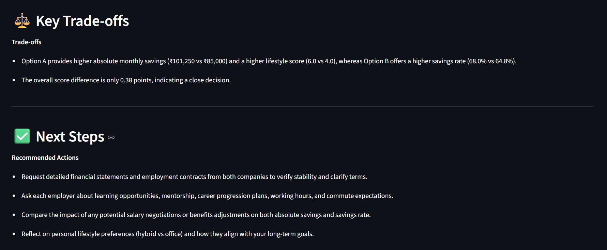
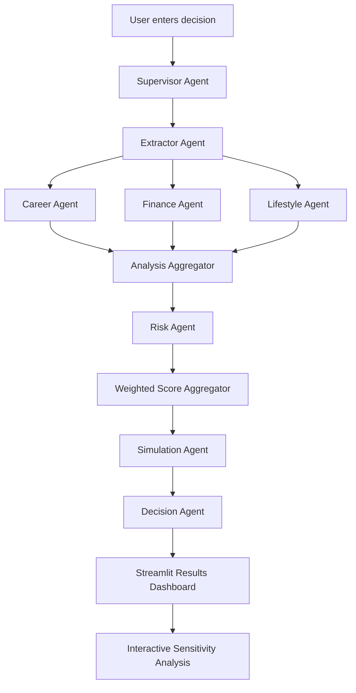

# 🧠 DecisionVerse
### Multi-Agent Decision Intelligence System

**What if an AI didn't just recommend an option, but showed you *why* — and how the answer changes when your priorities change?**

DecisionVerse is a locally runnable decision-support application that compares job offers through specialized AI agents. It evaluates **career growth, finances, lifestyle, and risk**, combines the results using transparent weighted scoring, estimates future financial outcomes, and explains the trade-offs behind its recommendation.

Built independently with **Python, LangGraph, Groq LLMs, and Streamlit**.

> **Status:** Working prototype · Runs locally 

**[Explore the code](https://github.com/TanyaChauhan15/Decision_Verse)** · **[Jump to setup](#-run-locally)**

---

## 📸 Product walkthrough

### 1. Describe a decision in plain English
Enter two job offers and their details, such as salary, location, role, and work arrangement.



### 2. Understand the scores
See how each option performs on career, finance, lifestyle, and risk, along with the weights used to combine them.



### 3. Change your priorities instantly
Adjust the importance of each factor and see the updated scores **without rerunning the AI agents**. This reuses the initial agent scores and recalculates the weighted totals.



### 4. Get a useful explanation, not just a winner
DecisionVerse highlights trade-offs and suggests questions to investigate before making a final choice.



---

## ✨ What makes it different?

| Capability | What it does |
| --- | --- |
| **Specialized agents** | Evaluates career, finance, lifestyle, and risk separately instead of relying on a single general-purpose response. |
| **Explainable scoring** | Shows factor scores, weights, overall scores, and the decision margin. |
| **Financial projections** | Estimates take-home pay, expenses, savings, and five-year cumulative savings using adjustable assumptions. |
| **Future scenarios** | Produces illustrative Year 1, Year 3, and Year 5 outcomes. |
| **Sensitivity analysis** | Recalculates recommendations when priorities change, without another LLM call. |
| **Actionable next steps** | Identifies missing information, risks, and practical follow-up questions. |

## 🏗️ How it works



**LangGraph** orchestrates the agents using a shared state. The extractor identifies the options and priorities; specialized agents evaluate each dimension; the scoring layer combines the results; and the decision agent produces an explanation grounded in the comparison.

### Scoring logic

Each option receives scores from 0 to 10. The overall score is a weighted sum:

$$
S = w_c C + w_f F + w_l L + w_r R
$$

Here, $C$, $F$, $L$, and $R$ represent **career, finance, lifestyle, and risk-safety** scores, respectively. The weights are normalized so that:

$$
w_c + w_f + w_l + w_r = 1
$$

The scoring weights reflect the user's priorities. They are visible in the UI and can be changed in the sensitivity analysis section. **Agent scores are heuristic estimates**, not objective measurements.

### Financial model

DecisionVerse uses deterministic calculations alongside LLM-generated analysis:

- **Monthly take-home:** annual salary × estimated take-home percentage ÷ 12
- **Monthly savings:** monthly take-home − monthly living expenses
- **Annual savings:** monthly savings × 12
- **Five-year projections:** apply assumed annual salary growth and living-cost inflation, then accumulate estimated annual savings

The app's documented default assumptions are **75% take-home pay, 8% annual salary growth, and 6% annual living-cost inflation**. Users can adjust these assumptions in the sidebar. These are simplified estimates, not predictions or guarantees.

---

## 🧪 Example: Two job offers

A user compares an **AI Engineer** role at StartupX (₹25 LPA, Bangalore, hybrid) with a **Data Scientist** role at MNCY (₹20 LPA, Hyderabad, office-based).

| Factor | Option A | Option B |
| --- | ---: | ---: |
| Career | 6.00 | 6.00 |
| Finance | 9.05 | 8.45 |
| Lifestyle | 6.00 | 4.00 |
| Risk safety | 5.00 | 5.00 |
| **Overall** | **6.62 / 10** | **6.24 / 10** |

With weights of **30% career, 30% finance, 10% lifestyle, and 30% risk**, Option A ranks slightly higher by **0.38 points**. It has higher estimated absolute monthly savings (₹1,01,250 vs ₹85,000) and a higher lifestyle score, while Option B has a higher estimated savings rate (68.0% vs 64.8%).

**The point isn't to claim that A is universally better:** DecisionVerse marks this as a close decision, explains the trade-offs, and recommends verifying missing information before committing. Example scores may vary between runs.

---

## 🛠️ Tech stack

| Technology | Role |
| --- | --- |
| **Python** | Application logic, financial calculations, and scoring |
| **LangGraph** | Multi-agent workflow orchestration and shared state |
| **Groq API + LLMs** | Natural-language analysis and explanations |
| **Streamlit** | Interactive interface and results dashboard |
| **Git / GitHub** | Version control and source hosting |

## 💡 Engineering challenges

**Coordinating multiple agents.** I used LangGraph and a shared decision state to organize the sequence of extraction, analysis, aggregation, simulation, and recommendation.

**Keeping numerical outputs interpretable.** Instead of relying only on free-form LLM recommendations, I combined specialized analysis with explicit financial formulas and weighted scoring, so users can inspect the numbers behind the result.

**Making the interface responsive to changing preferences.** The sensitivity engine recalculates overall scores from existing agent outputs. This avoids repeating expensive LLM inference every time a user moves a slider.

**Handling uncertainty.** The application highlights missing evidence, uses neutral risk-safety scores when information is insufficient, and frames future scenarios as illustrative rather than guaranteed.

---

## 🚀 Run locally

**Requirements:** Python 3.10+, Git, internet access, and a Groq API key.

### 1. Clone the repository

```bash
git clone https://github.com/TanyaChauhan15/Decision_Verse.git
cd Decision_Verse
```

### 2. Create and activate a virtual environment

**Windows PowerShell:**

```powershell
python -m venv .venv
.\.venv\Scripts\Activate.ps1
```

**macOS / Linux:**

```bash
python3 -m venv .venv
source .venv/bin/activate
```

### 3. Install dependencies

```bash
python -m pip install -r requirements.txt
```

### 4. Configure your Groq API key

Create a `.env` file in the project root containing a `GROQ_API_KEY` entry. To do this **without printing or committing your key**, run the following from **Windows PowerShell**:

```powershell
$secret = Read-Host 'Enter your Groq API key' -AsSecureString
$bstr = [Runtime.InteropServices.Marshal]::SecureStringToBSTR($secret)
try {
    $key = [Runtime.InteropServices.Marshal]::PtrToStringBSTR($bstr)
    [IO.File]::WriteAllText((Join-Path (Get-Location) '.env'), "GROQ_API_KEY=$key`n")
} finally {
    [Runtime.InteropServices.Marshal]::ZeroFreeBSTR($bstr)
}
```

Alternatively, create `.env` manually and set `GROQ_API_KEY` to your own key. **Never commit `.env` or API credentials.**

### 5. Start the app

```bash
python -m streamlit run app.py
```

Open the local URL printed by Streamlit in your browser.

### 6. Run scoring tests

```bash
python test_scoring.py
```

These tests cover deterministic scoring and sensitivity calculations; they are **not** a substitute for full end-to-end testing of the LLM workflow.

---

## 📂 Repository layout

```text
Decision_Verse/
├── agents/            # Specialized analysis agents
├── graph/             # LangGraph workflow
├── prompts/           # Agent prompts
├── rag/               # Retrieval-related components
├── state/             # Shared decision state
├── utils/             # Helpers and sensitivity calculations
├── app.py             # Streamlit application
├── main.py            # Additional entry point
├── test_scoring.py    # Scoring tests
├── test_rag.py        # Retrieval-related tests
├── requirements.txt   # Dependencies
└── README.md
```

## ⚠️ Current limitations

DecisionVerse is a **prototype**, not a production decision engine. Its scores are heuristic, its conclusions depend on the completeness of user-provided information, and it does not independently verify all employer-specific claims. Financial forecasts assume simplified growth and inflation rates; future scenarios are illustrative. Sensitivity analysis changes weights, **not** the original agent evaluations. The project currently runs locally and is not publicly hosted.

## 🔭 Potential improvements

Verified external data sources, stronger uncertainty estimation, additional decision categories, historical comparison tracking, downloadable reports, improved retrieval, and broader automated end-to-end testing.

---

## 👩‍💻 Built by

**Tanya Chauhan**  
B.Tech. Aerospace Engineering · Minor in Computer Science and Engineering  
Indian Institute of Technology Bombay (IIT Bombay)

**GitHub:** [TanyaChauhan15](https://github.com/TanyaChauhan15)

*DecisionVerse supports human judgment by making the reasoning behind a decision more transparent — it does not replace it.*
